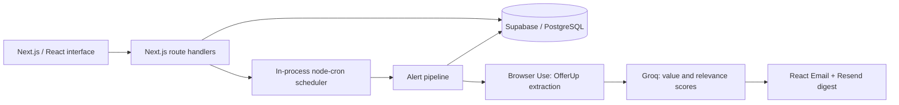

# Belfort Tips

An automated OfferUp deal scout built at **DiamondHacks 2026**, organized by ACM at UC San Diego.

Create an account, describe an item and location, and choose an alert schedule. A browser agent collects local listings, a language model scores their value and relevance, and the app emails a ranked digest.

This repository preserves a team hackathon project and its Git history. See [contribution evidence](docs/CONTRIBUTIONS.md) for Vaidik Nadheria's work on authentication and account flows.

## What it does

- Creates password-protected accounts with bcrypt hashes and separate sign-up/sign-in screens.
- Manages search alerts by item, location, radius, and frequency; alerts can be edited, paused, resumed, or cancelled.
- Searches **OfferUp** using Browser Use and validates the extracted listing data with Zod.
- Scores value and query relevance through Groq, adds a boost for listings not seen by that alert, and ranks new listings first.
- Sends HTML email digests through Resend and React Email, with links to the listings and alert controls.
- Stores users, alerts, and previously seen listing IDs in Supabase/PostgreSQL.

The current scraper supports OfferUp only. Earlier commits mention other marketplaces, but those integrations are not part of the current implementation. Scores are model estimates, not measured savings or verified market valuations.

## Architecture



The pipeline loads an active alert, fetches listings, compares their IDs with `seen_listings`, scores and ranks them, emails qualifying results, then records seen IDs and run timestamps.

## Stack

| Area | Technology |
| --- | --- |
| App and API | Next.js 16, React 19, TypeScript |
| UI | Tailwind CSS 4, shadcn/ui |
| Database | Supabase, PostgreSQL |
| Account credentials | bcryptjs, Zod |
| Listing extraction | Browser Use |
| Listing scoring | Groq SDK |
| Scheduling | node-cron |
| Email | Resend, React Email |

## Run locally

Use **Node.js 22 or later** and a Supabase development project.

```bash
git clone https://github.com/VaidikNadheria/diamond-hacks26.git
cd diamond-hacks26
npm ci
cp .env.example .env.local
```

1. In Supabase's SQL Editor, run [supabase/schema.sql](supabase/schema.sql) once against a fresh database. For an older database, follow the [migration instructions](supabase/migrations/README.md).
2. Fill in `.env.local` with your Supabase URL and server-side service-role key, Browser Use key, Groq key, and Resend key.
3. Configure a verified Resend sender, or use its permitted test sender and recipient.
4. Set `APP_BASE_URL` to the address where you will run the app.
5. Start the app:

```bash
npm run dev
```

Open [localhost:3000](http://localhost:3000), create an account, and add an alert. The first scan starts immediately; additional scans use the chosen schedule. Browser automation and external services require valid credentials and may incur charges.

| Setting | Purpose |
| --- | --- |
| `NEXT_PUBLIC_SUPABASE_URL` | Supabase project API URL |
| `SUPABASE_SERVICE_ROLE_KEY` | Server-side database API access |
| `BROWSER_USE_API_KEY` | Hosted browser agent |
| `GROQ_API_KEY` | Listing scoring |
| `RESEND_API_KEY` | Digest delivery |
| `RESEND_FROM_EMAIL` | Allowed sender identity |
| `APP_BASE_URL` | Base address for links in emails |
| `MIN_SCOUT_SCORE` | Minimum effective score for email inclusion; defaults to 40 |
| `DATABASE_URL` | Optional PostgreSQL connection string for migration scripts |

Keep `.env.local` private. The example file contains placeholders only.

## Validation

```bash
npm test
npm run lint
npm run typecheck
npm run build
```

Authentication tests mock database access and exercise the real route handlers, Zod validation, and bcrypt hashing. They make no database, browser-agent, model, or email requests. Live OfferUp extraction and email delivery need a separately configured development environment.

## Scheduling and prototype limits

The scheduler runs inside a long-lived Node.js process. It reloads active alerts at startup. Daily jobs fire at 09:00 and weekly jobs on Monday at 09:00 in the process's timezone; hourly and six-hour jobs align to cron boundaries. The one-minute option is intended for demonstrations.

This is a hackathon prototype. Account management URLs contain persistent bearer tokens; the current “Log out” button returns to the home page without revoking those tokens. Password recovery, rate limiting, distributed job locking, and durable background execution are not implemented. The manual trigger endpoint has no access check. Before a public deployment, address those controls and database access policies, and move scheduling to a durable worker if needed. Multiple app instances can otherwise run duplicate jobs.

A listing marked “new” means it has not been recorded for that alert before, rather than proving its posting date. Previously seen listings can still appear in later digests if they meet the score threshold. Live results also depend on marketplace availability, browser-agent output, and third-party API access.

## Team and attribution

The preserved history includes work by Mario Tapia, Ethan Fang, Jonny, and Vaidik Nadheria. Vaidik's original `vk` work added password authentication, database support, validation, and account UI changes. The browser extraction, scoring, scheduler, and email pipeline are team project features; see [the contribution record](docs/CONTRIBUTIONS.md) for precise authorship and links.

The original team repository is `m7tapia/diamond-hacks26` (private). This public copy retains the original commits. Subsequent portfolio improvements should be distinguished from the April 2026 hackathon work.
